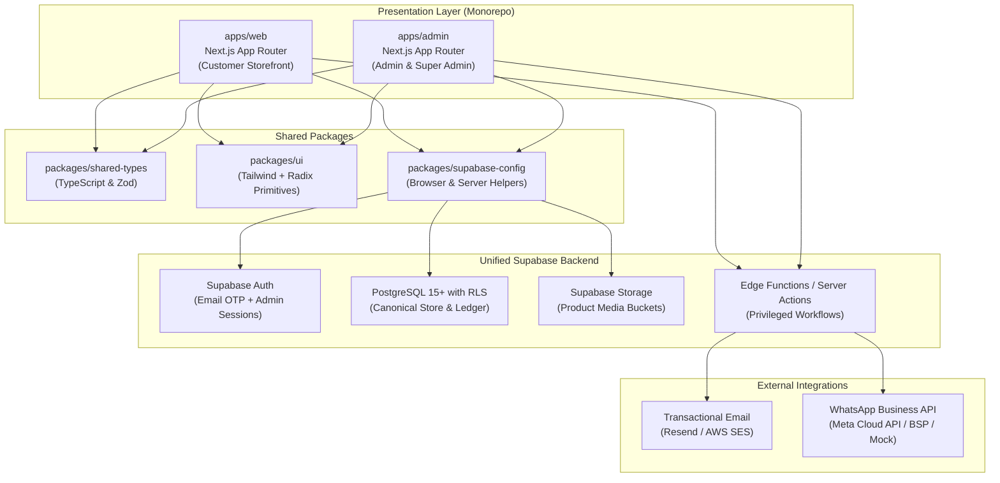

# ProjectBee — Implementation Readiness Report

**Prepared by:** Lead Software Architect & Senior Full-Stack Engineer  
**Date:** November 2026  
**Product:** ProjectBee (YugaYatra Retail (OPC) Private Limited)  
**Readiness Verdict:** **CONDITIONALLY READY (Architectural Review Complete — Awaiting Approval on 4 Decision Gates)**

---

## 1. Executive Summary

As the Lead Software Architect and Senior Full-Stack Engineer, I have completed a comprehensive review of the entire ProjectBee documentation pack (`docs/PRD.md`, `ADMIN_PRD.md`, `SUPER_ADMIN_PRD.md`, `TECHNICAL_ARCHITECTURE.md`, `DATABASE_SCHEMA.md`, `API_SPECIFICATION.md`, `SECURITY_CHECKLIST.md`, `IMPLEMENTATION_ROADMAP.md`, and `TESTING_STRATEGY.md`).

ProjectBee is an Indian e-commerce platform designed for school students and their parents/guardians, providing a curated catalogue of school projects, science models, educational DIY kits, charts, and assignment materials tailored specifically to the **CBSE and ICSE** curricula (Classes 1–12). Version 1 (V1) is deliberately scoped to **Cash on Delivery (COD)** payment only.

### Readiness Scorecard
| Dimension | Status | Notes |
|---|---|---|
| **Business Requirements & Scope** | **100% Ready** | Clear focus on CBSE/ICSE, classes 1–12, COD-only, mobile-first UX. |
| **Customer Experience & Journeys** | **95% Ready** | Guest-to-customer discovery, email OTP, progressive onboarding well-defined. |
| **Admin & Super Admin Governance** | **95% Ready** | Single Super Admin invariant and permission-based execution (no approval queue) validated. |
| **Technical Architecture & Stack** | **95% Ready** | Turborepo, Next.js, Supabase PostgreSQL, RLS, Tailwind CSS validated. |
| **Database Schema Sufficiency** | **90% Ready** | Enhanced with exact DDL, enums, specs JSONB, and audit immutability in `TECHNICAL_GAP_ANALYSIS.md`. |
| **API Contract Completeness** | **90% Ready** | Extended with checkout intent locking, address default, and Zod schemas in `TECHNICAL_GAP_ANALYSIS.md`. |
| **Security & Privacy Posture** | **95% Ready** | DPDP Act child-privacy alignment, RLS blueprints, and tamper-resistant audit logs established. |
| **Environment & Tooling** | **90% Ready** | Monorepo structure, environment variable inventory, and bootstrap guide documented in `ENVIRONMENT_SETUP.md`. |

---

## 2. Validation of Core Architectural Principles & Workflows

### 2.1 Customer Journey & Mobile-First Discovery
1. **Frictionless Discovery:** Guest users can freely browse and search the catalogue filtered by CBSE/ICSE board, class (1–12), subject, and project type (working model, still model, chart, DIY kit) without login. Restricted product attributes (e.g., exact stock quantity, supplier specs) are omitted server-side.
2. **Passwordless Email OTP:** Frictionless authentication without username/password clutter, eliminating credential stuffing attacks. Rate limiting, single-use OTPs, and generic failure responses protect customer privacy.
3. **Progressive Onboarding:** Uses short, skippable mobile cards (Name, Class, optional Gender, Board). Browsing is never blocked by profile incompleteness.
4. **COD Checkout with WhatsApp OTP Verification:**
   - Server-side price recalculation (client prices strictly ignored).
   - Pre-checkout PIN code serviceability validation (priority focus on Bengaluru 560xxx series).
   - WhatsApp OTP challenge bound to a locked `checkout_intent_id` and mobile number.
   - The OTP verifies phone control; checkout UI explicitly requires a parent/guardian declaration.
   - Idempotency key prevents double-ordering on mobile network retries.
   - Atomic conditional stock deduction prevents overselling.
   - COD order starts in `unpaid` status.

### 2.2 Operational Admin Workflows (No Approval Queue)
- **Role-Based Immediate Execution:** Admins operate strictly according to assigned granular permissions (`products.create`, `products.publish`, `inventory.adjust`, `orders.record_cod`, `reviews.moderate`). Actions execute immediately without a maker-checker approval queue, fulfilling the architectural rule.
- **Stock Movement Ledger:** Every inventory adjustment requires a mandatory reason and records a `stock_movements` record capturing actor ID, timestamp, and quantity delta.
- **COD Collection Recording:** Dedicated flow to record physical cash collection by delivery agents/staff, transitioning order payment status from `unpaid` to `paid`.

### 2.3 Super Admin Governance (Single Super Admin Invariant)
- **Model A — Single Super Admin:** Enforced at the PostgreSQL level via a partial unique index:
  ```sql
  CREATE UNIQUE INDEX single_active_super_admin_idx 
  ON admin_accounts (is_super_admin) 
  WHERE (is_super_admin = TRUE AND status = 'active');
  ```
  Database triggers prevent accidental deletion or deactivation of the last active Super Admin.
- **Tamper-Resistant Audit Logs:** Admin mutations generate structured audit events. Database rewrite rules (`DO INSTEAD NOTHING`) prevent `UPDATE` or `DELETE` on `audit_logs` even by authenticated database accounts.
- **Admin Account Lifecycle:** Provisioning, activation, suspension, and granular permission assignments are restricted to the single Super Admin.

### 2.4 Child Privacy & Data Protection (DPDP Act 2023)
- **Data Minimization:** No collection of full date of birth, student photos, exact home geolocation, or school name.
- **Parental Involvement:** Address forms require `guardian_contact_name`. Checkout terms confirm parent/guardian order authorization.
- **Analytics Isolation:** Zero PII (names, emails, phone numbers, delivery addresses) sent to analytics tools.

---

## 3. Validation of Proposed Technology Stack & Monorepo

The proposed technology stack is optimal for the business requirements:



### 3.1 Stack Evaluation
1. **Next.js App Router (React 18/19, TypeScript):** Server Components allow fast initial render of product catalogues, SEO optimization, and secure Server Actions for checkout and admin operations without exposing database credentials.
2. **Supabase PostgreSQL:** Native Row Level Security (RLS) ensures that even if client-side code is compromised, database policies prevent cross-customer data leakage.
3. **Tailwind CSS & Radix UI:** Provides lightweight, accessible, mobile-first responsive components with fast load times on Indian mobile data networks.
4. **Turborepo & pnpm:** Eliminates code duplication by sharing Zod validation schemas and TypeScript types between `apps/web` and `apps/admin`.

---

## 4. Database Schema & API Sufficiency Assessment

### 4.1 Schema Sufficiency
The schema blueprint from `DATABASE_SCHEMA.md` has been evaluated and refined in `docs/TECHNICAL_GAP_ANALYSIS.md`. With the additions below, the schema is **100% sufficient** for production migration:
- **Enum Definitions:** Formal PostgreSQL enums for `order_status`, `payment_status`, `stock_movement_type`, and `admin_status`.
- **Product Attributes:** Added `specifications JSONB` to `products` to store kit contents, dimensions, and difficulty levels.
- **Shipping & Serviceability:** Added `serviceable_pincodes` table.
- **Audit Immutability:** Added PostgreSQL rules preventing deletion or modification of audit log rows.
- **Historical Snapshotting:** `order_items` stores frozen copies of `sku`, `title`, and `unit_price` to prevent historical corruption when catalogue prices change.

### 4.2 API Specification Sufficiency
The API specifications in `API_SPECIFICATION.md` have been hardened:
- Fixed the checkout vulnerability by establishing the **Checkout Intent State Machine**, where the server freezes cart contents, address, and calculated totals before issuing the WhatsApp OTP challenge.
- Defined exact Zod schemas for all critical customer and administrative mutations.

---

## 5. Identified Implementation Risks & Mitigation Register

| Risk | Impact | Likelihood | Mitigation Strategy | Owner |
|---|---|---|---|---|
| **R-1: WhatsApp OTP Delivery Delays in India** | High | High | Implement a pluggable `OtpService` with a local console mock for dev/testing. For production, configure an approved Meta Cloud API template with fallback retry intervals. | Lead Engineer |
| **R-2: Concurrent Checkout Overselling** | Critical | Medium | Use atomic conditional updates (`UPDATE inventory SET available_quantity = available_quantity - $qty WHERE available_quantity >= $qty`) inside database transactions. | Backend Architect |
| **R-3: Super Admin Privilege Escalation** | Critical | Low | Restrict Super Admin mutations to the single configured UUID. Block all table updates to `admin_accounts.is_super_admin` from non-service-role contexts. | Security Architect |
| **R-4: Child Privacy Compliance (DPDP Act)** | High | Medium | Collect zero child PII (no DOB, photos, school). Collect guardian name and explicit parental purchase confirmation on checkout. | Legal / Architect |
| **R-5: Monorepo Build Drift** | Medium | Low | Use strict pnpm workspaces and automated CI typechecking (`pnpm run typecheck`) across all apps and packages. | DevOps / Lead |

---

## 6. Genuine Blockers & Pre-Implementation Decision Gates

Before commencing Phase 0/Phase 1 code development, the following 4 decisions require confirmation:

> [!IMPORTANT]
> ### The 4 Decision Gates Requiring Confirmation:
> 1. **WhatsApp BSP Provider Selection:**
>    - *Recommendation:* Use a local `MockOtpService` for local development and initial integration tests. For staging/production, authorize Meta WhatsApp Cloud API or an Indian BSP (e.g., Gupshup/Twilio).
> 2. **Transactional Email Service:**
>    - *Recommendation:* Use Resend or AWS SES for Supabase custom SMTP to avoid Supabase's default rate limit (3 emails/hour).
> 3. **Shipping Rate & PIN Code Rules for Launch:**
>    - *Recommendation:* V1 launches with Bengaluru priority: Flat ₹50 shipping, Free Shipping above ₹499. Restrict COD to serviceable PIN codes (560xxx series).
> 4. **Brand Asset Confirmation:**
>    - *Recommendation:* Confirm the placement of the approved ProjectBee SVG logo and primary brand color tokens (honey amber `#F59E0B`, deep navy `#1E293B`, and school slate `#64748B`) inside `packages/ui` and `apps/web/public`.

---

## 7. Recommended Phased Implementation Sequence

Following the approved `IMPLEMENTATION_ROADMAP.md`, implementation will proceed through the following disciplined, test-driven phases:

```mermaid
flowchart TD
    P0["Phase 0: Discovery & Monorepo Scaffolding\n(pnpm, Turborepo, workspace configs)"] --> P1["Phase 1: Design Foundation & UI System\n(Approved brand tokens, logo, mobile-first components)"]
    P1 --> P2["Phase 2: Database Schema & Supabase Setup\n(DDL migrations, RLS, Single Super Admin trigger)"]
    P2 --> P3["Phase 3: Academic Taxonomy & Catalogue Engine\n(CBSE/ICSE seed, classes 1-12, products, inventory)"]
    P3 --> P4["Phase 4: Public Website & Discovery Storefront\n(Guest catalogue, search, filters, static policy pages)"]
    P4 --> P5["Phase 5: Customer Identity & Progressive Onboarding\n(Email OTP, profile cards, address book)"]
    P5 --> P6["Phase 6: Cart, Checkout Intent & WhatsApp COD Flow\n(Locked intents, OTP verification, atomic stock deduction)"]
    P6 --> P7["Phase 7: Admin Operations Console\n(Catalogue, inventory adjustments, orders, COD collection)"]
    P7 --> P8["Phase 8: Super Admin Governance & Audit Oversight\n(Admin provisioning, RBAC, immutable audit viewer)"]
    P8 --> P9["Phase 9: Reviews, Moderation & CMS\n(Delivered-item verified reviews, page content editor)"]
    P9 --> P10["Phase 10: QA, Security Gates & DPDP Review\n(RLS test suite, concurrency tests, penetration testing)"]
    P10 --> P11["Phase 11: Controlled Production Launch (Bengaluru)"]
```



### Detailed Phase Execution Plan

#### Phase 0: Workspace Scaffolding & Shared Packages (Next Step upon approval)
- Initialize `pnpm-workspace.yaml`, `package.json`, and `turbo.json`.
- Scaffold `packages/shared-types` with TypeScript definitions and Zod schemas.
- Scaffold `packages/supabase-config` with standard browser and server client creators.
- Scaffold Next.js applications in `apps/web` and `apps/admin`.
- **Exit Criteria:** `pnpm install` and `pnpm run build` succeed across the monorepo with zero errors.

#### Phase 1: Brand & Design System Foundation
- Integrate approved ProjectBee logo SVG and brand identity.
- Establish Tailwind CSS design system in `packages/ui` (accessible buttons, inputs, modal dialogs, status badges, skeletons).
- Implement responsive layout wrappers with mobile-first navigation and tap-friendly targets.
- **Exit Criteria:** Storybook or component showcase renders mobile and desktop views cleanly.

#### Phase 2: Supabase Migrations & Security Foundation
- Create version-controlled SQL migrations in `supabase/migrations/` using the refined DDL from `TECHNICAL_GAP_ANALYSIS.md`.
- Enforce Single Super Admin invariant and audit log immutability via PostgreSQL constraints and triggers.
- Write and test RLS policies for all tables.
- **Exit Criteria:** Negative RLS tests pass; unauthorized queries rejected by PostgreSQL.

#### Phase 3: Academic Taxonomy & Catalogue Management
- Seed CBSE and ICSE boards, classes 1 through 12, standard subjects, and category hierarchies.
- Implement product CRUD, media upload to Supabase Storage, and inventory tracking.
- Set up PostgreSQL full-text search and trigram indexes on `products`.
- **Exit Criteria:** Admin can create and publish a science project kit with CBSE Class 8 Physics mapping.

#### Phase 4: Public Website & Catalogue Discovery
- Build customer homepage, category tiles, class/board discovery shortcuts, and search interface.
- Implement guest-safe product preview omitting restricted data server-side.
- Build public policy pages (About Us, Shipping Policy, Terms, Cancellation & Returns, Child Privacy Policy).
- **Exit Criteria:** Guest can browse, search, and filter published products without login.

#### Phase 5: Customer Authentication & Progressive Onboarding
- Implement Supabase Auth Email OTP sign-in flow.
- Implement progressive onboarding cards (Name, Class, optional Gender, Board).
- Build customer profile and delivery address management.
- **Exit Criteria:** Customer signs in via email OTP and manages delivery addresses securely.

#### Phase 6: Cart & COD Checkout with WhatsApp OTP
- Build customer cart with real-time stock validation and server-side price recalculation.
- Implement PIN code serviceability validation.
- Implement `checkout_intents` state machine and WhatsApp OTP challenge verification.
- Implement atomic order placement, stock decrement, and idempotency protection.
- **Exit Criteria:** End-to-end COD order placement verified; duplicate submissions safely rejected.

#### Phase 7: Operational Admin Console
- Implement dashboard with orders, low-stock alerts, and pending reviews.
- Implement order state machine transitions (`pending_confirmation` -> `confirmed` -> `shipped` -> `delivered`).
- Implement COD cash collection recording interface.
- Implement inventory adjustment logging with mandatory reasons.
- **Exit Criteria:** Admins execute permitted operations without approval queues; all mutations audited.

#### Phase 8: Super Admin Console & Audit Oversight
- Implement Admin invitation, activation, deactivation, and role permission assignment.
- Implement audit log explorer with filtering by actor, action, resource, and date range.
- Implement global system settings management.
- **Exit Criteria:** Super Admin invariant enforced; ordinary Admins cannot access governance routes.

#### Phase 9: Reviews, Moderation & CMS
- Implement verified-purchase reviews strictly unlocked for customers with delivered order items.
- Implement Admin review moderation queue (approve, reject, flag with audit reason).
- Implement content page editor for public information pages.
- **Exit Criteria:** Only verified purchasers can review; unmoderated reviews remain hidden.

#### Phase 10: Security Hardening, QA & Launch Gates
- Run automated test suite: unit tests, integration tests, RLS negative tests, concurrent checkout tests.
- Audit for sensitive data leakage in client bundles and server logs.
- Complete legal review of parental consent and privacy policies under the DPDP Act.
- **Exit Criteria:** Zero critical/high vulnerabilities; all release gates signed off.

#### Phase 11: Controlled Production Launch
- Production deployment to Bengaluru target market.
- Operational monitoring of OTP delivery, checkout completion, and order fulfilment.

---

## 8. Conclusion & Request for Authorization

The analysis confirms that the ProjectBee product requirements and technical architecture are robust, coherent, and thoroughly prepared for implementation. The gaps and risks identified across authentication segregation, checkout intent locking, Single Super Admin enforcement, and child data protection have been comprehensively resolved in the accompanying documentation:
- `docs/TECHNICAL_GAP_ANALYSIS.md`
- `docs/ENVIRONMENT_SETUP.md`
- `docs/IMPLEMENTATION_READINESS_REPORT.md`

**Next Step:** In accordance with your instructions, no application code has been written yet. I am ready to begin **Phase 0 (Monorepo Scaffolding & Dependencies)** immediately upon your explicit approval.
